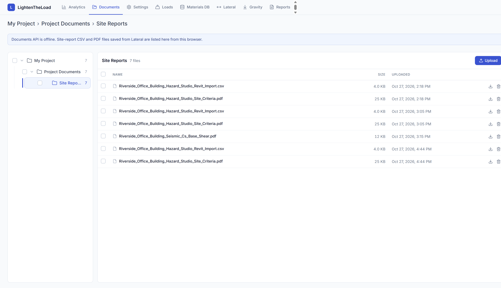
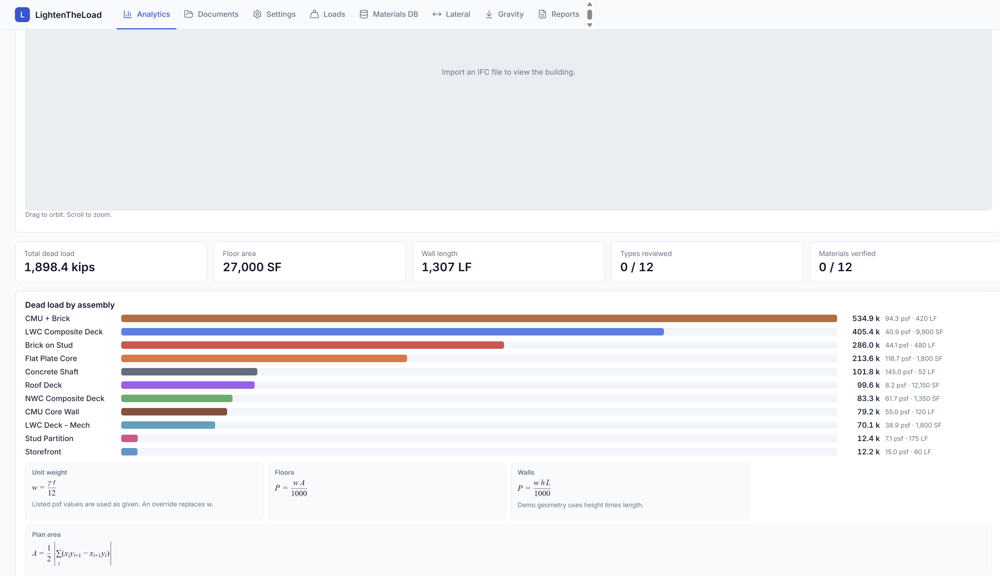
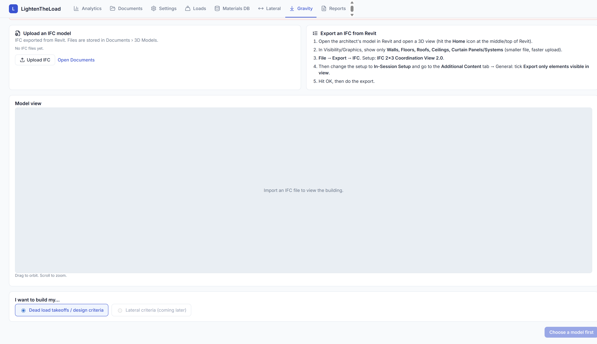
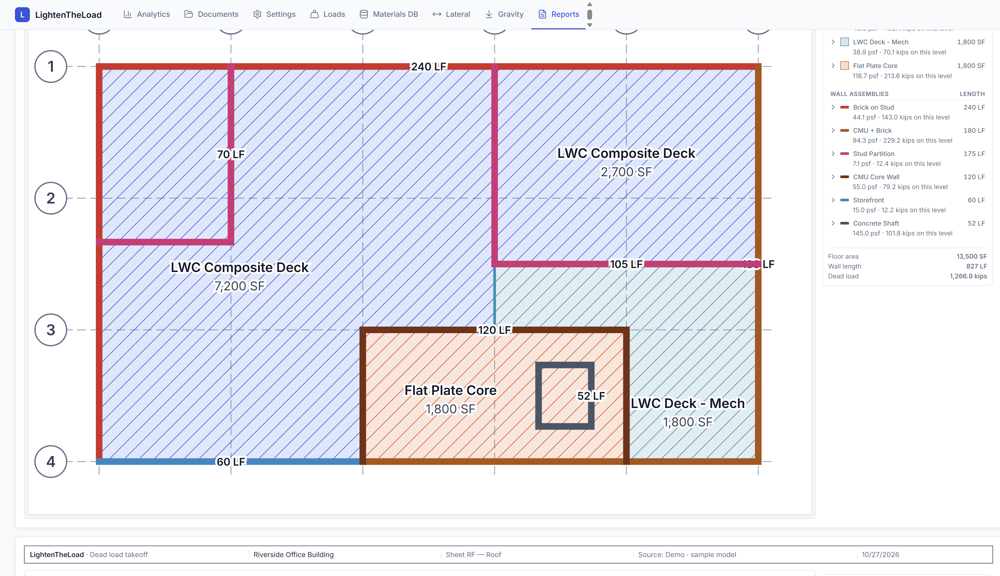
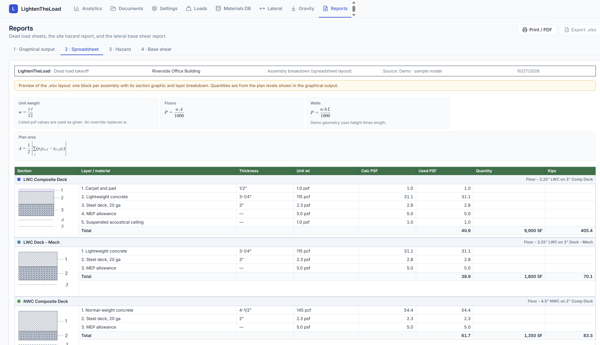
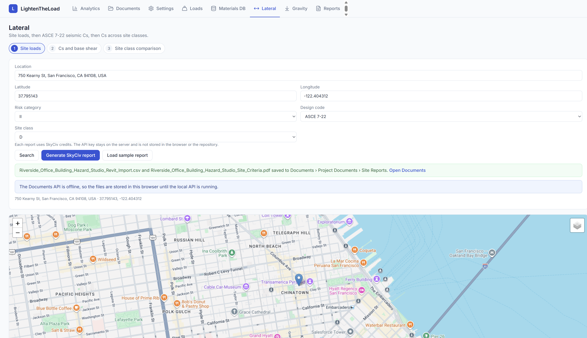
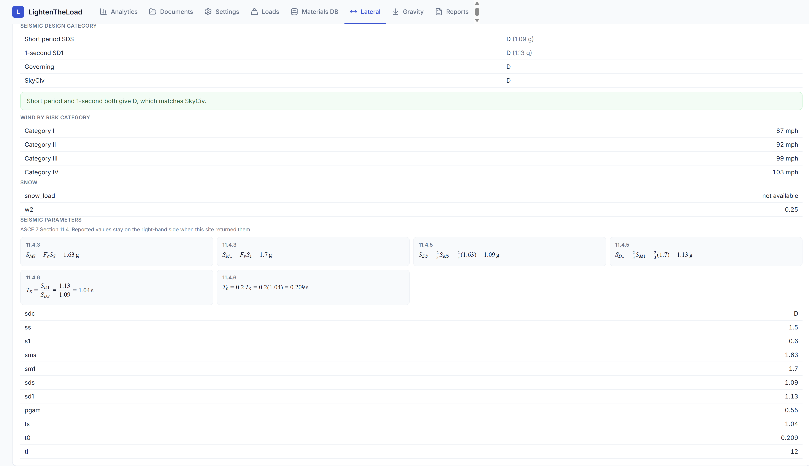
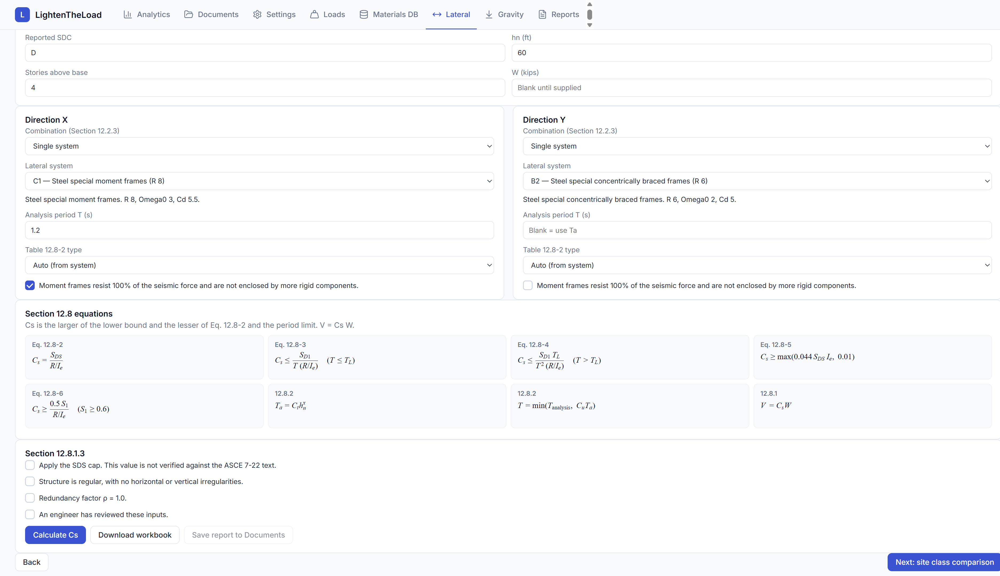

# LightenTheLoad

[](LICENSE)
[](https://github.com/mattuan36/ncsea-hackathon/actions/workflows/pages.yml)
[](frontend)
[](backend)
[](frontend/package.json)
[](backend)
[](docker-compose.yml)
[](https://mattuan36.github.io/ncsea-hackathon/)

Structural web app for dead-load takeoff and ASCE 7 lateral site criteria. The React frontend (Vite + TypeScript) talks to a FastAPI backend. Documents and models live in PostgreSQL. The published site is [mattuan36.github.io/ncsea-hackathon](https://mattuan36.github.io/ncsea-hackathon/). A push to `main` builds `frontend/` and deploys it with GitHub Pages.

Preliminary output. Confirm hazards, assemblies, and coefficients before design use.

## Screens

Captured from the running app. The building is the Riverside Office demo. The site report is the Kearny Street sample.

**Documents.** Folder tree, upload, and the site-report files saved from Lateral.



**Analytics.** Dead load by assembly, with the unit-weight and area equations under the chart.



**Gravity.** IFC upload and the Revit export steps. Floor types, assemblies, and the plan open after a model is read.



**Plan sheets.** Markup plan, quantities, and the assembly legend.



**Spreadsheet sheet.** Layer breakdown next to the section graphic.



**Site loads.** Search or drop a pin in the United States, Alaska, or Puerto Rico.



**Site coefficients.** ASCE 7 Section 11.4, typeset from the sample report.



**Cs and base shear.** ASCE 7-22 Section 12.8. After Calculate, the governing equation is marked.



## Menus

| Menu | What it does |
|---|---|
| Analytics | Takeoff summary: kips, floor area, wall length, dead load by assembly |
| Documents | Upload, download, and delete. Files are stored in Postgres, 200 MB max |
| Settings | Project info and the material database |
| Loads | Load criteria for the takeoff |
| Materials DB | Unit weights used by the assemblies |
| Lateral | Site wind, snow, and seismic, then Cs and a site-class comparison |
| Gravity | Dead-load takeoff from an IFC model |
| Reports | Plan sheets, spreadsheet layout, hazard report, base shear |

Lateral calls the site API (`VITE_API_BASE`, or the local proxy). That process holds `SKYCIV_USERNAME` and `SKYCIV_KEY`. The key is not in the browser or the repo. Documents, models, and materials need the local API.

### What is still sample data

Gravity, Reports, Settings, and Analytics can run on the in-memory demo (`frontend/src/ltl/data.ts`). Choosing a source without a parsed model shows that same sample. State in `frontend/src/ltl/store.tsx` resets on reload until a model is saved.

Real math on that demo:

- Unit weight in pcf: \(w = \gamma t / 12\). A listed psf is used as given. An override replaces it.
- Plan area is the shoelace formula. Wall length is the polyline length.
- Floors: kips \(= w \times \mathrm{SF} / 1000\). Demo walls: \(w \times h \times \mathrm{LF} / 1000\). An IFC wall uses net area with openings removed.

Material unit weights are typical values. Check them against ASCE 7 Table C3.1-1 before design use.

Not built yet: persistence of every takeoff edit, and `.xlsx` export from Reports (the button is disabled). IFC parsing for an uploaded model is the Gravity path in `gravity_ifc/`.

Gravity steps: Model → Floor types → Wall types → Build assemblies → Type table → Plan view.

## Equations

The pages render these with [KaTeX](https://katex.org/). The same relations are in `frontend/src/math/Equation.tsx` and in `code/part3_seismic_base_shear/calculation.py`.

Dead load:

$$
w = \frac{\gamma \, t}{12}
\qquad
P = \frac{w A}{1000}
$$

\(\gamma\) is pcf, \(t\) is thickness in inches, \(w\) is psf, \(A\) is square feet, \(P\) is kips.

Site coefficients, ASCE 7 Section 11.4:

$$
S_{MS} = F_a S_S
\qquad
S_{DS} = \tfrac{2}{3} S_{MS}
\qquad
S_{M1} = F_v S_1
\qquad
S_{D1} = \tfrac{2}{3} S_{M1}
$$

$$
T_S = \frac{S_{D1}}{S_{DS}}
\qquad
T_0 = 0.2 \, T_S
$$

Seismic response coefficient, ASCE 7-22 Section 12.8.1.1. \(C_s\) is the larger of the lower bound and the lesser of Eq. 12.8-2 and the period limit.

$$
C_s = \frac{S_{DS}}{R/I_e}
\qquad
C_s \le \frac{S_{D1}}{T\,(R/I_e)} \;\; (T \le T_L)
\qquad
C_s \le \frac{S_{D1} T_L}{T^{2} (R/I_e)} \;\; (T > T_L)
$$

$$
C_s \ge \max(0.044 \, S_{DS} I_e,\; 0.01)
\qquad
C_s \ge \frac{0.5 \, S_1}{R/I_e} \;\; (S_1 \ge 0.6)
\qquad
V = C_s W
$$

Approximate period, Section 12.8.2:

$$
T_a = C_t h_n^{x}
\qquad
T = \min(T_{\mathrm{analysis}},\; C_u T_a)
$$

Blank \(W\) stays symbolic. It is not taken as zero. Warnings do not block a result. ELF eligibility, irregularities, redundancy, and vertical distribution are not checked. The Section 12.8.1.3 \(S_{DS}\) cap in this tool is not verified against the ASCE 7-22 text.

## Run

```bash
docker compose up -d
cd backend && python3 -m venv .venv && .venv/bin/pip install -r requirements.txt
.venv/bin/uvicorn app.main:app --port 8100 --reload --reload-dir app
cd frontend && npm install && npm run dev
```

Postgres 16 is on `localhost:55432`. The app is at [http://localhost:5180](http://localhost:5180). The API creates its tables from `backend/schema.sql` and a default folder tree on first start.

The Lateral page calls `POST /api/site-report` on port 8101. That process does not use Postgres. It reads `SKYCIV_USERNAME` and `SKYCIV_KEY` from the environment, `.env`, or `API_Key.txt`.

```bash
cd backend && python3 -m venv .venv && .venv/bin/pip install -r requirements-site.txt
.venv/bin/uvicorn app.site_api:app --port 8101
```

Cs uses the Part 3 service on port 8003. See [code/part3_seismic_base_shear/README.md](code/part3_seismic_base_shear/README.md). The Vite dev server proxies `/api/seismic` to it.

## Documents API

| Method | Path | |
|---|---|---|
| GET | `/api/folders` | Flat folder list with recursive `file_count` |
| GET | `/api/documents?folder_id=&recursive=` | Files in a folder |
| POST | `/api/documents` | Multipart `folder_id` + `files[]` |
| GET | `/api/documents/{id}/download` | File bytes as an attachment |
| DELETE | `/api/documents/{id}` | Remove a file |

The folder tree is seeded (`SEED_TREE` in `backend/app/db.py`). There is no create or rename folder control. Checking a folder selects every file under it. Delete always asks first.

## Tests

```bash
cd backend && .venv/bin/python -m pytest -q
```

The document tests need the Docker database running.

```bash
cd code/part3_seismic_base_shear && python -m pytest -q
```

## Layout

| Path | |
|---|---|
| `frontend/` | React app |
| `backend/` | Documents, models, materials, and the site API |
| `gravity_ifc/` | IFC extraction and dead-load matching. [Notes](gravity_ifc/README.md) |
| `code/part3_seismic_base_shear/` | ASCE 7-22 Cs and base shear |
| `docs/screenshots/` | Pictures in this file |

## License

[MIT](LICENSE)
